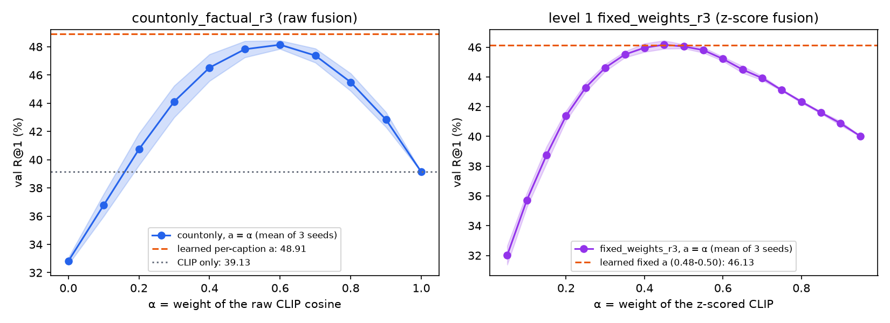

# Quét α và kết quả theo nhóm câu cho `countonly_factual_r3` (val)

Script `scripts/improve/alpha_groups_countonly.py` tính cả hai phần, chỉ trên val, không đọc test.

- Với mỗi seed, điểm từng kênh của 50 ứng viên được tính một lần trong bộ nhớ, không dump ra đĩa.
- Fusion raw là tuyến tính theo điểm kênh, nên mọi α được fuse lại bằng numpy theo đúng `fuse_raw`: kênh thiếu điểm lấy
  trung bình các ứng viên có điểm.
- Kiểm tra: dùng lại trọng số đã học thì điểm khớp mô hình tới 1,1e-7, và R@1 trùng đúng `metrics.json` của cả 3 seed.

Kết quả: `alpha_sweep.json`, `groups.json`, `alpha_sweep.png`. Log: `alpha_groups.log`.

## Việc 6 — Quét α

Trọng số CLIP được ép a = α cho mọi câu. b và c giữ tỉ lệ đã học của từng câu:
b' = (1 − α)·b/(b + c), c' = (1 − α)·c/(b + c). Số liệu là mean ± std qua 3 seed, val, %.

| α | R@1 | R@5 | R@10 | MRR |
|---|---|---|---|---|
| 0 (chỉ đồ thị) | 32,81 ± 0,24 | 61,53 ± 0,24 | 74,03 ± 0,36 | 46,30 ± 0,20 |
| 0,1 | 36,77 ± 0,79 | 65,07 ± 0,83 | 76,79 ± 0,80 | 49,96 ± 0,69 |
| 0,2 | 40,73 ± 1,13 | 68,38 ± 0,93 | 79,25 ± 1,07 | 53,53 ± 1,08 |
| 0,3 | 44,12 ± 1,12 | 71,13 ± 1,22 | 81,50 ± 1,02 | 56,53 ± 1,09 |
| 0,4 | 46,52 ± 0,94 | 73,00 ± 1,03 | 83,12 ± 0,74 | 58,66 ± 0,88 |
| 0,5 | 47,82 ± 0,58 | 74,38 ± 0,62 | 84,11 ± 0,66 | 59,88 ± 0,58 |
| **0,6** (tốt nhất trên lưới) | **48,14 ± 0,30** | 74,98 ± 0,40 | 84,74 ± 0,26 | 60,26 ± 0,22 |
| 0,7 | 47,37 ± 0,50 | 74,54 ± 0,25 | 84,46 ± 0,08 | 59,72 ± 0,32 |
| 0,8 | 45,49 ± 0,62 | 73,30 ± 0,49 | 83,58 ± 0,36 | 58,20 ± 0,53 |
| 0,9 | 42,84 ± 0,53 | 70,96 ± 0,51 | 81,88 ± 0,37 | 55,82 ± 0,48 |
| 1 (chỉ CLIP) | 39,13 | 67,88 | 78,97 | 52,34 |
| **a học theo từng câu** (mô hình chính) | **48,91 ± 0,21** | 75,22 ± 0,05 | 84,96 ± 0,25 | 60,86 ± 0,22 |

- **Hai đầu mút.** α = 1 cho đúng CLIP thuần (39,13). α = 0, tức chỉ dùng đồ thị, đạt 32,81: tự đồ thị kém CLIP, nhưng
  kết hợp thì vượt cả hai.
- **a học theo từng câu tốt hơn mọi α cố định.**
  - Hơn α tốt nhất trên lưới 0,77 điểm R@1 (48,91 so với 48,14). Mức này lớn hơn bất kỳ độ lệch chuẩn nào của lưới.
  - α tốt nhất được chọn trên chính val, nên số của nó còn lạc quan; khoảng cách thật có thể còn lớn hơn.
  - Trung bình a học được trên các câu val là 0,57 ± 0,06 (0,55 / 0,53 / 0,64 theo seed), gần điểm tốt nhất 0,6 của
    lưới. Phần lời thêm đến từ việc a đổi theo từng câu.
- **So với cấp 1** (`fixed_weights_r3`, `experiments/level1/controls/alpha_sweep_fixed_weights_r3_seed*.json`, lưới 0,05–0,95):
  - α tốt nhất là 0,45, cho R@1 46,17 ± 0,28.
  - a cố định học trên train (0,49 / 0,50 / 0,48) cho 46,13 ± 0,15.
  - Ở cấp 1, trọng số theo từng câu chỉ hơn trọng số cố định 0,35 điểm. Ở mô hình mới, khoảng cách là 0,77.
- **Thang điểm khác nhau, không so được α giữa hai bên.**
  - Cấp 1 dùng fusion z-score: α nhân với CLIP đã chuẩn hoá trong top-50, và đồ thị cũng được z-score.
  - Mô hình mới dùng fusion raw: α nhân thẳng cosine CLIP (khoảng 0,2–0,35, lệch nhau cỡ 0,02 trong một top-50), còn b, c
    nhân điểm kênh thô (khoảng 0,5–0,95).
  - Cùng một giá trị α vì vậy cho ảnh hưởng tương đối rất khác nhau. Chỉ so được hình dạng đường cong và khoảng cách giữa
    "a học" và "α tốt nhất".

## Việc 7 — Kết quả theo nhóm câu

Các nhóm được định nghĩa một lần, từ đồ thị câu FACTUAL của count_v1, đúng như lúc xếp hạng (`GraphStore._graph_parts`:
bỏ đại từ, che nhãn rỗng). Mọi mô hình dùng chung các nhóm này.

- **Có số nêu rõ:** câu có ít nhất một node vật thể chấm được thuộc lớp 1 / 2 / 3–4 / ≥5.
- **Có quan hệ:** sau khi bỏ đại từ, câu còn ít nhất một quan hệ.
- **Số vật thể:** số node vật thể chấm được. Không câu val nào có 0 vật thể.

Cách đo:
- CLIP là thứ tự top-50 của cấp 1. main_r3 và countonly mỗi bên 3 seed, ghi mean ± std. R@1 của từng seed trùng
  `metrics.json`.
- Khoảng tin cậy 95% (KTC) lấy bằng bootstrap ghép cặp theo câu, trên tỉ lệ đúng đã trung bình qua seed (2 000 lần lấy
  mẫu, rng 2026).
- p là Welch giữa 3 seed countonly và 3 seed main_r3.

| Nhóm | N | CLIP R@1 | main_r3 R@1 | countonly R@1 | countonly − CLIP [KTC 95%] | countonly − main_r3 [KTC 95%] | p (Welch) | MRR CLIP / main_r3 / countonly |
|---|---|---|---|---|---|---|---|---|
| Tất cả | 10 633 | 39,13 | 46,48 ± 0,24 | 48,91 ± 0,21 | +9,78 [9,02; 10,57] | +2,43 [1,92; 2,93] | 0,0002 | 52,34 / 58,85 / 60,86 |
| Có số nêu rõ | 1 235 (11,6%) | 44,21 | 50,69 ± 0,08 | 54,06 ± 1,09 | +9,85 [7,58; 12,09] | +3,37 [1,75; 4,91] | 0,033 | 56,59 / 63,01 / 65,80 |
| Không có số nêu rõ | 9 398 (88,4%) | 38,47 | 45,92 ± 0,27 | 48,23 ± 0,11 | +9,77 [8,98; 10,58] | +2,31 [1,77; 2,85] | 0,0014 | 51,78 / 58,31 / 60,21 |
| Có ≥1 quan hệ | 10 342 (97,3%) | 39,31 | 46,83 ± 0,25 | 49,38 ± 0,20 | +10,08 [9,32; 10,86] | +2,55 [2,02; 3,07] | 0,0002 | 52,52 / 59,17 / 61,26 |
| Chỉ vật thể | 291 (2,7%) | 32,99 | 33,91 ± 0,40 | 32,19 ± 1,05 | −0,80 [−4,70; 2,98] | −1,72 [−4,70; 1,37] | 0,091 | 45,75 / 47,56 / 46,39 |
| 1 vật thể | 269 (2,5%) | 31,97 | 33,33 ± 0,21 | 31,47 ± 1,14 | −0,50 [−4,71; 3,47] | −1,86 [−4,96; 1,24] | 0,10 | 44,83 / 46,94 / 45,48 |
| 2 vật thể | 3 757 (35,3%) | 35,67 | 40,87 ± 0,20 | 42,41 ± 0,40 | +6,74 [5,59; 7,93] | +1,54 [0,72; 2,40] | 0,0098 | 49,36 / 53,90 / 55,35 |
| ≥3 vật thể | 6 607 (62,1%) | 41,40 | 50,20 ± 0,35 | 53,32 ± 0,25 | +11,92 [10,95; 12,88] | +3,11 [2,45; 3,77] | 0,0004 | 54,33 / 62,16 / 64,61 |

Hai nhóm "chỉ vật thể" và "1 vật thể" gần như trùng nhau: một câu chỉ có một vật thể thì không thể có quan hệ.

### Kết luận: tri thức quan hệ giúp ở đâu

1. **Phần lời nằm ở các câu mô tả nhiều vật thể và quan hệ giữa chúng.**
   - So với CLIP, mô hình tăng +6,7 điểm R@1 ở câu 2 vật thể và +11,9 điểm ở câu từ 3 vật thể trở lên.
   - Ở câu chỉ có một vật thể và không có quan hệ (2,7% số câu), mô hình không hơn CLIP (−0,8, KTC [−4,7; 3,0]).
   - Khi câu chỉ nêu một thứ, đồ thị không thêm thông tin gì ngoài cái CLIP đã thấy.
2. **Mô hình mới hơn cấp 1 ở mọi nhóm có quan hệ, và hơn nhiều nhất ở câu dài.** Ở câu ≥3 vật thể, nó hơn main_r3
   +3,1 điểm; ở câu 2 vật thể, +1,5 điểm.
3. **Câu có số nêu rõ được lợi thêm.** Ở nhóm này, countonly hơn main_r3 +3,4 điểm, so với +2,3 ở các câu còn lại. Điều
   này khớp với phép bỏ g lúc eval: R@1 của nhóm có số giảm 1,6 điểm. Nhưng nhóm chỉ chiếm 11,6% số câu, và độ lệch giữa
   các seed lớn (± 1,09), nên đóng góp vào R@1 tổng có hạn.
4. **Ở nhóm câu chỉ có vật thể, mô hình mới thấp hơn main_r3 1,7 điểm, nhưng chưa có ý nghĩa thống kê** (KTC chứa 0,
   p = 0,09, N = 291). Nếu đây là thật, một cách giải thích có thể là trọng số dồn vào kênh bộ ba: trung bình trên val,
   mô hình mới có b ≈ 0,12 và c ≈ 0,33 (seed 0). Với câu không có quan hệ, kênh bộ ba là hằng số cho mọi ảnh, nên thứ hạng
   chỉ còn do a·CLIP + b·S(vật thể), với b nhỏ. Đây là giả thuyết, chưa kiểm.
5. **Tóm lại:**
   - Tri thức quan hệ giúp truy vấn khi câu tả một cảnh có nhiều thành phần liên kết với nhau; đây là 97% số câu
     COCO val.
   - Lợi càng lớn khi câu càng nhiều vật thể, và lớn thêm khi câu nói rõ số lượng.
   - Với câu chỉ nêu một vật thể, nên tin CLIP.
