# Attention của GAT trên cạnh tự thêm — ví dụ val (fullgraph_factual_r3_seed0)

Mỗi ảnh là ảnh đúng của một câu val. Mũi tên xanh là 6 cạnh tự thêm (vị từ `[none]`) có attention lớp 1 cao nhất, đi từ node nguồn tới node nhận (chấm tròn); số là thứ hạng và alpha (trung bình 4 head; alpha là softmax trên các cạnh đi vào node nhận, kể cả self-loop). Khung đỏ là hai đầu của các cạnh đó, khung xám là node khác. Chọn ngẫu nhiên (seed 0): 8 câu mô hình xếp ảnh đúng hạng 1, 4 câu xếp hạng 2–10.

## 430525_2 — hạng ảnh đúng 1

> a woman sitting on a bench wearing a dress and some other people

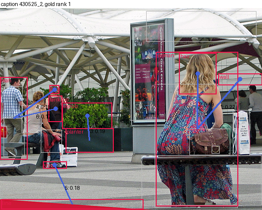

| # | nguồn → nhận | alpha lớp 1 | alpha lớp 2 | bậc vào của node nhận |
|---|---|---|---|---|
| 1 | woman#21 → wall#20 | 0.217 | 0.083 | 7 |
| 2 | woman#21 → hair#5 | 0.192 | 0.095 | 7 |
| 3 | planter#11 → shrub#15 | 0.187 | 0.124 | 7 |
| 4 | man#8 → hair#6 | 0.181 | 0.093 | 7 |
| 5 | line#7 → shoe#14 | 0.181 | 0.130 | 7 |
| 6 | man#8 → tank top#18 | 0.170 | 0.073 | 7 |

## 455624_3 — hạng ảnh đúng 1

> A man who is riding a silver motorcycle with the number 120 on it.

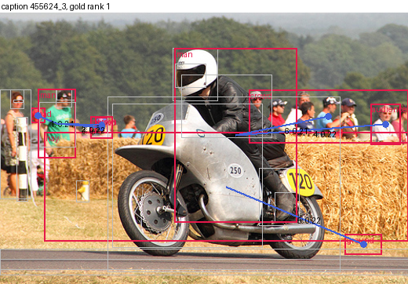

| # | nguồn → nhận | alpha lớp 1 | alpha lớp 2 | bậc vào của node nhận |
|---|---|---|---|---|
| 1 | man#16 → head#10 | 0.244 | 0.113 | 7 |
| 2 | man#16 → head#11 | 0.226 | 0.109 | 7 |
| 3 | man#16 → person#20 | 0.221 | 0.109 | 7 |
| 4 | man#17 → audience#0 | 0.219 | 0.089 | 7 |
| 5 | hay#9 → ground#7 | 0.217 | 0.131 | 7 |
| 6 | man#17 → crowd#4 | 0.213 | 0.090 | 7 |

## 139749_0 — hạng ảnh đúng 1

> An airport with lots of people walking to and fro.

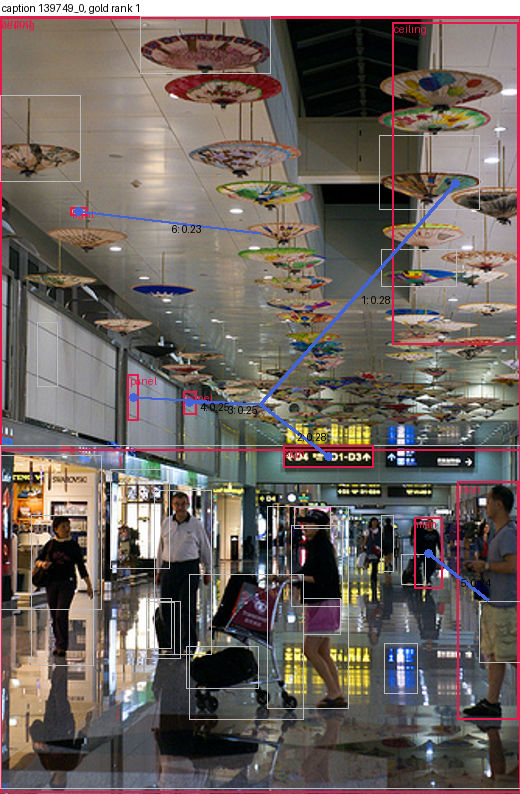

| # | nguồn → nhận | alpha lớp 1 | alpha lớp 2 | bậc vào của node nhận |
|---|---|---|---|---|
| 1 | airport#0 → ceiling#29 | 0.281 | 0.116 | 7 |
| 2 | airport#0 → sign#20 | 0.276 | 0.087 | 7 |
| 3 | airport#0 → panel#14 | 0.248 | 0.094 | 7 |
| 4 | airport#0 → panel#16 | 0.247 | 0.098 | 7 |
| 5 | man#12 → man#11 | 0.239 | 0.118 | 7 |
| 6 | ceiling#3 → light#7 | 0.229 | 0.070 | 7 |

## 317763_3 — hạng ảnh đúng 1

> A wire stretched across a computer keyboard with lights.

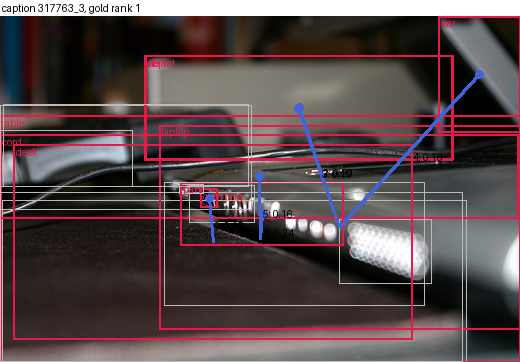

| # | nguồn → nhận | alpha lớp 1 | alpha lớp 2 | bậc vào của node nhận |
|---|---|---|---|---|
| 1 | table#4 → part#14 | 0.239 | 0.118 | 7 |
| 2 | laptop#2 → item#8 | 0.202 | 0.120 | 7 |
| 3 | laptop#2 → object#11 | 0.186 | 0.119 | 7 |
| 4 | laptop#2 → bar#0 | 0.164 | 0.103 | 7 |
| 5 | table#4 → cord#3 | 0.161 | 0.157 | 7 |
| 6 | desk#17 → opening#12 | 0.150 | 0.092 | 7 |

## 530407_2 — hạng ảnh đúng 1

> Two elephants standing next to each other on a field.

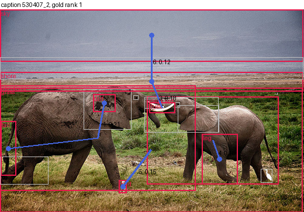

| # | nguồn → nhận | alpha lớp 1 | alpha lớp 2 | bậc vào của node nhận |
|---|---|---|---|---|
| 1 | elephant#5 → dirt#2 | 0.209 | 0.103 | 7 |
| 2 | elephant#5 → tail#15 | 0.198 | 0.109 | 7 |
| 3 | tusk#17 → shore#13 | 0.178 | 0.141 | 7 |
| 4 | elephant#6 → leg#11 | 0.158 | 0.101 | 7 |
| 5 | grass#9 → bird#0 | 0.155 | 0.096 | 7 |
| 6 | shore#13 → sky#14 | 0.122 | 0.110 | 7 |

## 507887_1 — hạng ảnh đúng 1

> Slices of pizza and glass of wine displayed on wooden table.

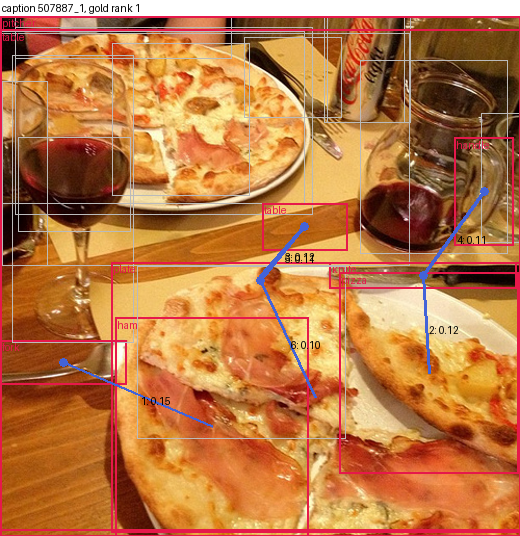

| # | nguồn → nhận | alpha lớp 1 | alpha lớp 2 | bậc vào của node nhận |
|---|---|---|---|---|
| 1 | ham#8 → fork#2 | 0.154 | 0.113 | 7 |
| 2 | pizza#16 → knife#10 | 0.124 | 0.150 | 7 |
| 3 | pitcher#14 → table#21 | 0.120 | 0.079 | 8 |
| 4 | knife#10 → handle#9 | 0.115 | 0.118 | 7 |
| 5 | table#20 → table#21 | 0.106 | 0.072 | 8 |
| 6 | plate#18 → table#20 | 0.103 | 0.107 | 7 |

## 442809_2 — hạng ảnh đúng 1

> a counter top with some cup cakes sitting on it

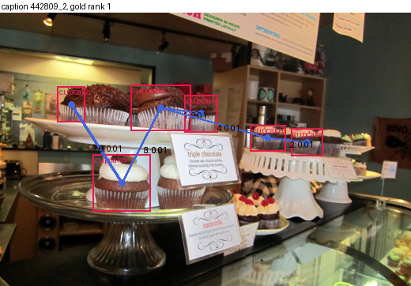

| # | nguồn → nhận | alpha lớp 1 | alpha lớp 2 | bậc vào của node nhận |
|---|---|---|---|---|
| 1 | cupcake#1 → cupcake#2 | 0.015 | 0.069 | 7 |
| 2 | cupcake#4 → cupcake#5 | 0.014 | 0.067 | 7 |
| 3 | cupcake#0 → cupcake#1 | 0.014 | 0.110 | 7 |
| 4 | cupcake#1 → cupcake#4 | 0.011 | 0.054 | 7 |
| 5 | cupcake#1 → cupcake#0 | 0.011 | 0.080 | 7 |
| 6 | cupcake#0 → cupcake#3 | 0.011 | 0.094 | 7 |

## 357229_0 — hạng ảnh đúng 1

> A whole cheese pizza with a fork and a knife on a table.

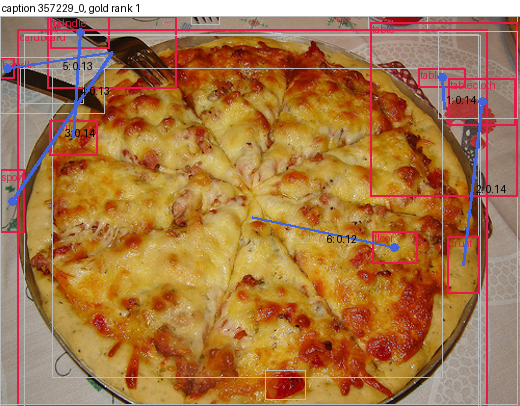

| # | nguồn → nhận | alpha lớp 1 | alpha lớp 2 | bậc vào của node nhận |
|---|---|---|---|---|
| 1 | table#18 → table#16 | 0.140 | 0.079 | 7 |
| 2 | crust#4 → tablecloth#19 | 0.136 | 0.132 | 8 |
| 3 | fork#6 → sport#12 | 0.135 | 0.103 | 7 |
| 4 | knife#20 → handle#9 | 0.131 | 0.114 | 7 |
| 5 | fork#6 → handle#8 | 0.126 | 0.071 | 7 |
| 6 | cardboard#1 → floor#5 | 0.121 | 0.076 | 7 |

## 377231_0 — hạng ảnh đúng 4

> A group of three zebras standing in a grassy area.

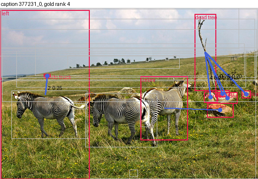

| # | nguồn → nhận | alpha lớp 1 | alpha lớp 2 | bậc vào của node nhận |
|---|---|---|---|---|
| 1 | zebra#27 → boulder#6 | 0.256 | 0.116 | 7 |
| 2 | left#11 → white truck#23 | 0.249 | 0.092 | 7 |
| 3 | dead tree#1 → boulder#2 | 0.213 | 0.085 | 7 |
| 4 | dead tree#1 → boulder#3 | 0.208 | 0.082 | 7 |
| 5 | dead tree#1 → boulder#5 | 0.202 | 0.099 | 7 |
| 6 | dead tree#1 → boulder#4 | 0.196 | 0.082 | 7 |

## 30706_2 — hạng ảnh đúng 4

> A man with beard taking a photograph with a cellphone.

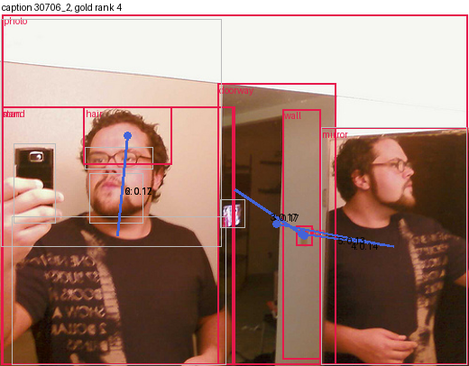

| # | nguồn → nhận | alpha lớp 1 | alpha lớp 2 | bậc vào của node nhận |
|---|---|---|---|---|
| 1 | photo#7 → switch#10 | 0.170 | 0.097 | 7 |
| 2 | man#4 → hair#3 | 0.167 | 0.094 | 7 |
| 3 | photo#7 → wall#14 | 0.165 | 0.119 | 7 |
| 4 | mirror#5 → wall#14 | 0.145 | 0.115 | 7 |
| 5 | mirror#5 → doorway#0 | 0.130 | 0.103 | 7 |
| 6 | stand#9 → hair#3 | 0.117 | 0.090 | 7 |

## 441535_3 — hạng ảnh đúng 5

> A blanket and pillows that are on a bed.

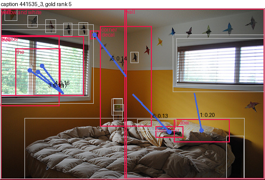

| # | nguồn → nhận | alpha lớp 1 | alpha lớp 2 | bậc vào của node nhận |
|---|---|---|---|---|
| 1 | wall#23 → pillow#19 | 0.198 | 0.117 | 7 |
| 2 | wall#22 → the#28 | 0.173 | 0.109 | 7 |
| 3 | wall#22 → outside#18 | 0.165 | 0.121 | 7 |
| 4 | wall#22 → tree#21 | 0.160 | 0.111 | 7 |
| 5 | corner#12 → bird decal#6 | 0.135 | 0.116 | 7 |
| 6 | yellow and white#26 → comforter#11 | 0.131 | 0.089 | 7 |

## 81054_2 — hạng ảnh đúng 3

> A beige SUV parked outside on the curb.

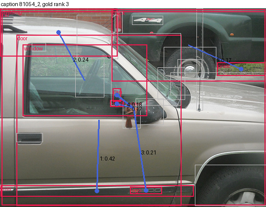

| # | nguồn → nhận | alpha lớp 1 | alpha lớp 2 | bậc vào của node nhận |
|---|---|---|---|---|
| 1 | door#6 → trim#17 | 0.419 | 0.179 | 7 |
| 2 | window#21 → building#3 | 0.243 | 0.144 | 7 |
| 3 | car#5 → logo#11 | 0.208 | 0.121 | 7 |
| 4 | car#5 → can#4 | 0.175 | 0.099 | 7 |
| 5 | car#5 → drink holder#8 | 0.173 | 0.096 | 7 |
| 6 | truck#18 → grass#9 | 0.172 | 0.090 | 7 |

