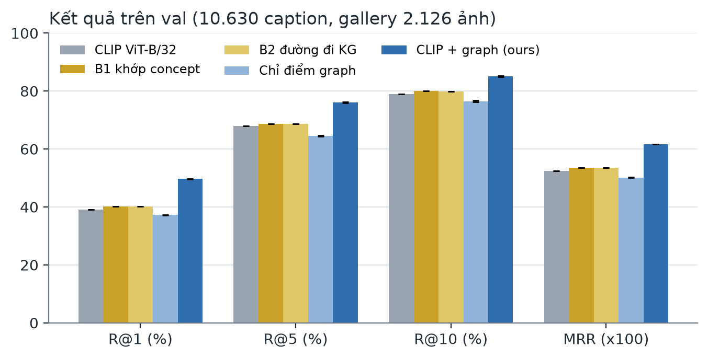
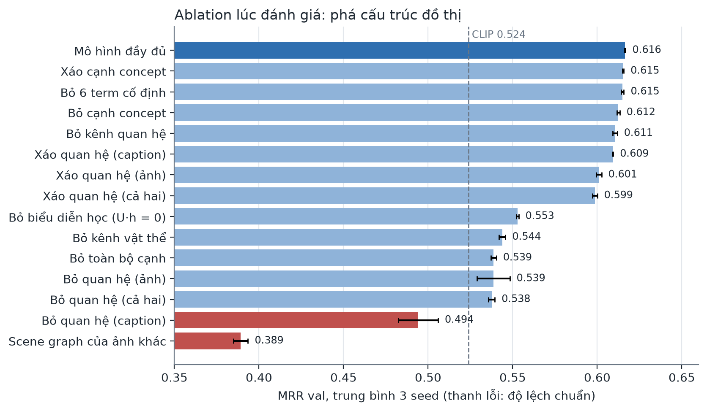
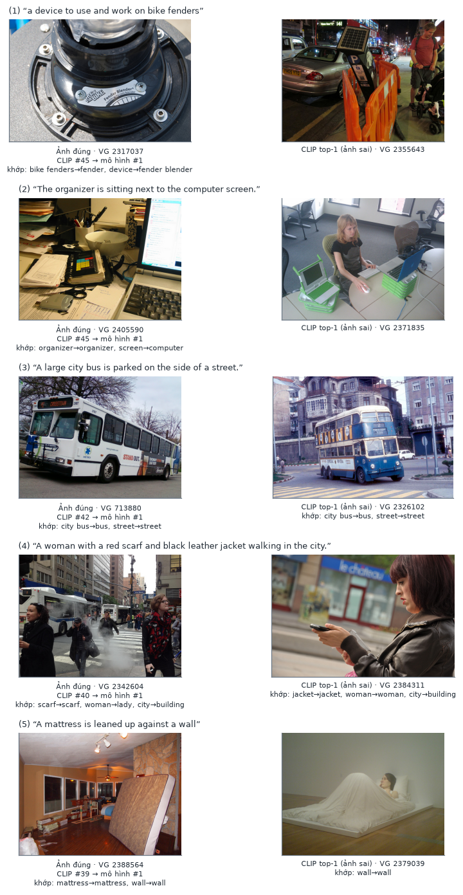
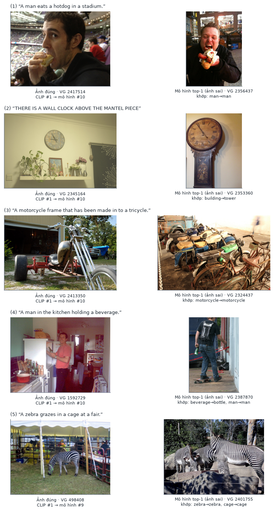
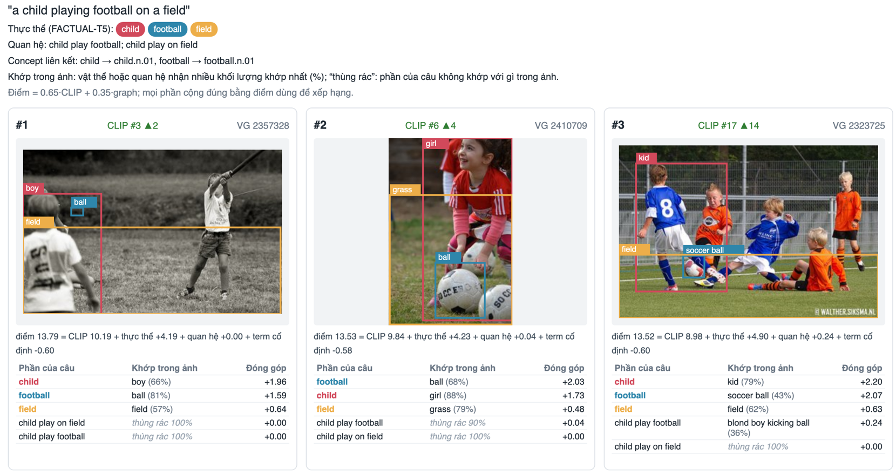

# Scene ranker: khớp scene graph câu và ảnh bằng Sinkhorn trên CLIP B/32

Người làm: Nguyễn Bùi Mẫn Nhi (25C15055).
Mô hình được phát triển, train và chấm test trong repo cá nhân `nhinbm/multimodal-graph-retrieval-xai`, trên cùng split VG ∩ COCO (Karpathy) và cùng CLIP ViT-B/32 với repo nhóm.
Bốn thành phần của nó đã được đưa vào `GraphReranker` của nhóm dưới dạng cờ (PR #33, `docs/scene-ranker.html`), nhưng chưa được train trên repo nhóm.
Mọi số trong file này lấy từ các file kết quả đã chép nguyên từ repo cá nhân vào `experiments/improve/scene-ranker/personal-repo/` (mục 8).

## Tóm tắt

CLIP đóng băng lấy top-50 ứng viên.
Câu được FACTUAL-T5 tách thành scene graph, ảnh dùng scene graph VG.
Hai graph được mã hóa bằng cùng một bộ mã hóa (GAT trên concept graph và 2 lớp attention trên cạnh scene graph), rồi khớp từng phần bằng Sinkhorn có thùng rác (dustbin).
Điểm cuối là 0,65·CLIP + 0,35·graph, và chính các cặp khớp là lời giải thích.

Trên **test** (chạy đúng một lần, 3 seed), mô hình đạt R@1 48,57 ± 0,36 và MRR@50 60,76 ± 0,21, so với 39,32 và 51,99 của CLIP thuần.
So với mô hình chính của nhóm (`countonly_factual_r3`), R@1 cao hơn +0,63 điểm nhưng chưa có ý nghĩa thống kê với 3 seed (Welch p = 0,079); MRR@50 cao hơn +0,61 (p = 0,018).
Hai mô hình gần ngang nhau; đây là một hướng thứ hai đạt cùng mức, không phải thay thế mô hình chính.

## 1. Khác biệt so với pipeline của nhóm

| Hạng mục | Repo nhóm (`countonly_factual_r3`) | Scene ranker (repo cá nhân) |
|---|---|---|
| Split, gallery | Karpathy, test 2.138 ảnh | Như nhóm |
| Số caption val / test | 10.633 / 10.696 | 10.630 / 10.690 |
| CLIP | ViT-B/32, top-50 | ViT-B/32, top-50; CLIP test R@1 39,32 như nhóm |
| Đồ thị câu | FACTUAL-T5 large | FACTUAL-T5 base (`flan-t5-base-VG-factual-sg`) |
| Khớp phần câu với phần ảnh | softmax theo từng phần của câu | Sinkhorn có thùng rác |
| Tri thức ngoài | không | concept graph WordNet + ConceptNet + đồng xuất hiện VG trên train, qua GAT |
| MRR | trong top-50 (hạng > 50 tính 0) | toàn gallery; mục 3 tính lại theo cách của nhóm |

Hai bộ caption lệch 3 câu ở val và 6 câu ở test do hai repo xử lý dữ liệu độc lập.
Lệch này nhỏ hơn 0,06% số câu nên không đổi kết luận, nhưng là lý do bảng so sánh ở mục 3 ghi rõ số câu của từng bên.

## 2. Mô hình

**Ứng viên.**
Top-50 CLIP.
Khi train, top-50 lấy trong một nhóm ảnh train cố định cỡ gallery val (ảnh train chia ngẫu nhiên thành 22 nhóm khoảng 2.133 ảnh), để danh sách ứng viên lúc train giống lúc chạy thật.
Caption có ảnh đúng ngoài top-50 giữ nguyên hạng CLIP.

**Hai scene graph.**
Câu: FACTUAL-T5 tách thành thực thể, thuộc tính và bộ ba (chủ thể, vị từ, đối tượng), tối đa 8 thực thể và 6 quan hệ.
Ảnh: annotation VG, 64 vật thể có khung lớn nhất, tối đa 4 thuộc tính mỗi vật thể, 64 quan hệ.

**Mã hóa nút.**
Mỗi nút gộp vectơ CLIP text của tên ("a photo of a {name}"), của thuộc tính, đặc trưng số (IDF; tỉ lệ khung và số lượng ở phía ảnh) và vectơ concept sau GAT:

$$\mathbf h^{(0)}_n = W \mathbf f_n + \overline{W_a \mathbf f_a} + W_x \mathbf x_n + \overline{\operatorname{GAT}(\mathbf z)_c}.$$

GAT 2 lớp, 4 head, chạy trên concept graph (1.687 synset xuất hiện trong ≥ 20 ảnh train, 13.807 cạnh: 1.486 `hypernym` WordNet, 12.114 `vg_prior` đồng xuất hiện trên ảnh train, 207 ConceptNet 5.7), có loại cạnh và log trọng số cạnh trong logit chú ý.
Sau đó 2 lớp attention dùng chung cho câu và ảnh truyền tin dọc cạnh quan hệ của scene graph.
Vectơ để khớp là $\mathbf p_n = \operatorname{normalize}(\mathbf f_n + U \mathbf h_n)$ với U khởi tạo 0, nên mô hình chưa train trùng với so khớp CLIP text thuần.

**Khớp Sinkhorn có thùng rác.**
Hai kênh: thực thể câu với vật thể ảnh, quan hệ câu với quan hệ ảnh.
Mỗi kênh đưa ma trận cosine qua 20 vòng Sinkhorn với nhiệt độ τ và điểm thùng rác z học được:

$$P = \operatorname{Sinkhorn}(\mathrm{sim}/\tau,\ z), \qquad S_{\text{ch}} = \sum_i w_i \sum_j P_{ij}\, \mathrm{sim}_{ij}.$$

Mỗi phần của câu gửi đi một đơn vị khối lượng và mỗi phần của ảnh nhận tối đa một đơn vị.
Phần không có đối tác đủ tốt đi vào thùng rác và không cộng điểm, nên một vật thể của ảnh không bị tính nhiều lần.

**Điểm và loss.**

$$\text{graph} = \beta_o \frac{S_o}{s_o} + \beta_r \frac{S_r}{s_r} + \sum_{t=1}^{6} d_t \frac{T_t}{s_t}, \qquad \text{final} = \alpha \frac{\cos(q, I)}{s_{\text{clip}}} + (1 - \alpha)\, \text{graph}, \quad \alpha = 0{,}65.$$

Sáu term cố định: điểm đường đi B2, thuộc tính khớp theo từ và theo CLIP text, số lượng, độ nổi bật theo diện tích, và độ giống giữa cụm danh từ và nhãn vật thể.
Loss là $\operatorname{CE}(\text{final}/T, y) + 0{,}3\,\operatorname{CE}(\text{graph}/T_g, y)$; số hạng thứ hai buộc riêng phần đồ thị cũng tự xếp hạng được.
709.469 tham số, AdamW lr 0,001, batch 64 caption, tối đa 10 epoch, chọn epoch theo MRR val.

**Chống rò rỉ.**
Từ vựng concept, IDF và cạnh `vg_prior` chỉ đếm trên ảnh train.
α, epoch và mọi siêu tham số chọn trên val.
Test mở đúng một lần (run 0070), sau khi cùng code đánh giá chạy lại toàn bộ chuỗi trên val và khớp từng bước với các run đã lưu (run 0069: ứng viên, concept, link, hạng B1/B2, hạng của 3 checkpoint lệch 0, 1 và 0 trên 10.630 caption).
Scene graph của ảnh là annotation VG thật (oracle), giống repo nhóm.

## 3. Kết quả

**Bảng 1.** Val và test, MRR tính trên toàn gallery như trong repo cá nhân.
B1 cộng IDF các concept của câu có trong ảnh; B2 mở rộng B1 bằng đường đi ≤ 2 cạnh trên concept graph; cả hai trộn với CLIP ở α = 0,85.

| Split | Mô hình | R@1 | R@5 | R@10 | MRR |
|---|---|---|---|---|---|
| Val (10.630) | CLIP | 39,14 | 67,89 | 78,98 | 0,5239 |
| | B1 | 40,20 | 68,76 | 79,99 | 0,5350 |
| | B2 | 40,25 | 68,72 | 79,93 | 0,5352 |
| | **Scene ranker (3 seed)** | **49,69 ± 0,05** | **76,00 ± 0,18** | **85,11 ± 0,12** | **0,6165 ± 0,0003** |
| Test (10.690) | CLIP | 39,32 | 66,38 | 77,32 | 0,5203 |
| | B1 | 40,37 | 67,46 | 78,39 | 0,5307 |
| | B2 | 40,41 | 67,46 | 78,40 | 0,5314 |
| | **Scene ranker (3 seed)** | **48,57 ± 0,36** | **75,28 ± 0,03** | **84,54 ± 0,11** | **0,6080 ± 0,0021** |

Trên test, từng seed hơn CLIP với CI95% của ΔMRR (bootstrap ghép cặp theo ảnh) là [+0,079; +0,097], [+0,077; +0,094] và [+0,081; +0,098].
Từ val sang test, MRR giảm 0,0085, còn CLIP giảm 0,0036; phần tăng so với CLIP còn +0,088 so với +0,093 trên val, tức giữ khoảng 95%.

**Bảng 2.** So với mô hình chính của nhóm trên test, cùng cách tính của nhóm (MRR với hạng > 50 tính 0), Welch t-test 3 seed mỗi bên.

| Chỉ số | Scene ranker (10.690 câu) | `countonly_factual_r3` (10.696 câu) | Chênh | p |
|---|---|---|---|---|
| R@1 | 48,57 ± 0,36 | 47,95 ± 0,15 | +0,63 | 0,079 |
| R@5 | 75,28 ± 0,03 | 74,79 ± 0,03 | +0,49 | < 0,001 |
| R@10 | 84,54 ± 0,11 | 84,38 ± 0,08 | +0,16 | 0,134 |
| MRR@50 | 60,76 ± 0,21 | 60,15 ± 0,15 | +0,61 | 0,018 |

CLIP thuần tính theo cùng cách trong repo cá nhân cho R@1 39,32 và MRR@50 51,99, khớp với 39,32 và 52,00 của repo nhóm, nên hai bên đo cùng một thang.
Với độ lệch giữa seed rất nhỏ ở R@5, p nhỏ phản ánh độ ổn định hơn là một khác biệt lớn; chênh lệch ở mọi chỉ số đều dưới 0,7 điểm.

*Hình 1. CLIP, B1, B2, điểm graph đứng riêng và scene ranker trên val (thanh lỗi: độ lệch chuẩn qua 3 seed).*

## 4. Ablation

**Bảng 3.** Ablation lúc đánh giá trên val (checkpoint đã train, phá đồ thị lúc chấm), trung bình qua 3 seed.

| Biến thể | MRR | R@1 |
|---|---|---|
| Mô hình đầy đủ | 0,6165 ± 0,0003 | 49,69 |
| Xáo cạnh concept graph | 0,6153 ± 0,0004 | 49,56 |
| Bỏ cạnh concept graph | 0,6124 ± 0,0009 | 49,14 |
| Bỏ 6 term cố định | 0,6150 ± 0,0008 | 49,58 |
| Bỏ kênh quan hệ | 0,6105 ± 0,0013 | 48,99 |
| Xáo cạnh scene graph (câu và ảnh) | 0,5986 ± 0,0015 | 47,62 |
| Bỏ cạnh scene graph (câu và ảnh) | 0,5375 ± 0,0019 | 40,86 |
| Bỏ phần học được (U·h = 0) | 0,5528 ± 0,0007 | 42,57 |
| Chấm bằng scene graph của ảnh khác | 0,3892 ± 0,0043 | 24,96 |
| CLIP | 0,5239 | 39,14 |

*Hình 2. MRR val của các ablation lúc đánh giá (đỏ: thấp hơn CLIP).*

Chấm bằng scene graph của ảnh khác làm MRR rơi dưới CLIP, nên điểm đồ thị thật sự đọc nội dung của đúng ảnh.
Phá cạnh lúc đánh giá đưa đầu vào ra ngoài phân phối train, nên mức giảm là cận trên của vai trò cạnh.
Train lại từ đầu không có cạnh nào (run 0065, seed 0) đạt MRR val 0,6071, chỉ thua mô hình có cạnh 0,0097 (CI95% [−0,0141; −0,0055]): cạnh đóng góp khoảng 10% phần tăng so với CLIP, phần còn lại đến từ việc khớp từng phần của câu với từng vật thể của ảnh.
Kết luận này cùng chiều với ablation bỏ cạnh của nhóm (R@1 val giảm 2,39 điểm).

## 5. Giải thích và 10 truy vấn

Điểm cuối là tổng các số hạng, nên giải thích của một cặp (câu, ảnh) là bảng các số hạng đó: phần CLIP, từng thực thể và quan hệ của câu (vật thể hoặc quan hệ của ảnh nhận nhiều khối lượng nhất, phần vào thùng rác, đóng góp vào điểm), và từng term cố định.
Ba kiểm tra trên val, seed 0:

- Tổng các phần khớp điểm cuối với sai số tối đa 1,4·10⁻⁵ trên 10 ứng viên đầu của mọi caption.
- Phép thử xoá: với 10 caption có ảnh đúng ở hạng 1, xoá vật thể đóng góp nhiều nhất làm điểm giảm mạnh hơn xoá ngẫu nhiên ở 10/10 ca (trung bình −1,45 so với +0,006); 5/10 ca ảnh đúng mất hạng 1.
- Không có caption nào trong 6.195 caption có ít nhất hai thực thể được khớp mà mọi thực thể dồn vào một vật thể.

**Năm truy vấn thành công** (CLIP xếp ảnh đúng ở hạng 39-45, mô hình đưa lên hạng 1):

| Truy vấn | CLIP → mô hình | Cặp khớp quyết định (khối lượng; đóng góp) |
|---|---|---|
| "a device to use and work on bike fenders" | 45 → 1 | bike fenders → fender (0,84; +2,31), device → fender blender (0,53; +1,60) |
| "The organizer is sitting next to the computer screen." | 45 → 1 | organizer → organizer (0,92; +2,73), screen → computer (0,59; +1,86) |
| "A large city bus is parked on the side of a street." | 42 → 1 | city bus → bus (0,85; +3,64), street → street (0,57; +1,32) |
| "A woman with a red scarf and black leather jacket walking in the city." | 40 → 1 | scarf → scarf (0,57; +2,30), woman → lady (0,73; +0,89) |
| "A mattress is leaned up against a wall" | 39 → 1 | mattress → mattress (0,95; +3,62), "mattress lean against wall" → "mattress against wall" (+0,79) |

**Năm truy vấn thất bại** (CLIP xếp ảnh đúng ở hạng 1, mô hình đẩy xuống hạng 9-10):

| Truy vấn | CLIP → mô hình | Nguyên nhân |
|---|---|---|
| "A man eats a hotdog in a stadium." | 1 → 10 | Scene graph ảnh đúng thiếu "man" và "hot dog"; mọi thực thể vào thùng rác |
| "THERE IS A WALL CLOCK ABOVE THE MANTEL PIECE" | 1 → 10 | FACTUAL-T5 phân tích sai "mantel piece" thành "building" |
| "A motorcycle frame that has been made in to a tricycle." | 1 → 10 | Ảnh đúng gán nhãn xe là "cart"; câu mô tả một biến đổi |
| "A man in the kitchen holding a beverage." | 1 → 10 | Annotation ảnh đúng chỉ có tường và tranh |
| "A zebra grazes in a cage at a fair." | 1 → 9 | Ảnh đúng thiếu nhãn "zebra" |

Nguyên nhân chính của thất bại là annotation thiếu trong ảnh đúng; giải thích chỉ ra phần nào của câu rơi vào thùng rác, nên lỗi chẩn đoán được mà không cần đoán.

## 6. Demo

Repo cá nhân có notebook `notebooks/demo.ipynb`: nhập một câu tự do, trả về top-k ảnh của gallery val, mỗi ảnh có hạng so với CLIP, điểm tách thành từng phần và khung vật thể được khớp.
Demo đi qua đúng chuỗi đã đánh giá; chạy lại 256 caption val qua demo như câu tự do cho ra cùng hạng với run đã lưu, điểm graph lệch tối đa 2,7·10⁻⁵.
Bản đã chạy, kèm toàn bộ output, được lưu ở `notebooks/scene-ranker-demo.ipynb` của repo này; bản đó chỉ để xem, vì code và checkpoint nằm ở repo cá nhân.

*Hình 3. Truy vấn "a child playing football on a field": các ảnh CLIP xếp hạng 3, 6 và 17 được đưa lên đầu nhờ khớp child → boy/girl/kid, football → ball/soccer ball, field → field/grass.*

## 7. Hạn chế

- Scene graph của ảnh là annotation thật (oracle), như repo nhóm; annotation thiếu đã là lỗi chính ngay cả trong thiết lập này.
- α, epoch và các lần thử trước đều chọn trên val; trên test MRR thấp hơn val 0,0085.
- Train lại không cạnh mới có một seed.
- Chưa train trong repo nhóm: các cờ của PR #33 trên `countonly_factual_r3` (`experiments/improve/scene-ranker/run.sh`) chưa chạy, nên chưa biết bốn thành phần này có cộng thêm vào mô hình chính hay không.

## 8. Nguồn số liệu

Thư mục `experiments/improve/scene-ranker/personal-repo/` chứa file chép nguyên từ `artifacts/runs/` của repo cá nhân (commit `cdb4b5b`), không sửa tay:

| Mục | File |
|---|---|
| Test, mở một lần (run 0070) | `test_eval_0070_metrics.json`, `test_eval_0070_test_ranks.npz`, `test_eval_0070_config.json` |
| Tái lập val trước khi mở test (run 0069) | `test_eval_0069_val_metrics.json`, `test_eval_0069_val_ranks.npz` |
| Ba seed (run 0056/0057/0063), train lại không cạnh (0065) | `rank_train_<run>_metrics.json` |
| Ablation lúc đánh giá (0058/0062/0064) | `rank_ablation_<run>_metrics.json` |
| Bảng 2 | `comparison_test.json`, sinh bằng `python scripts/improve/compare_scene_ranker.py` |
| Năm thành công, năm thất bại, hình | báo cáo của repo cá nhân, `docs/report/report.md` mục 4.5 |
